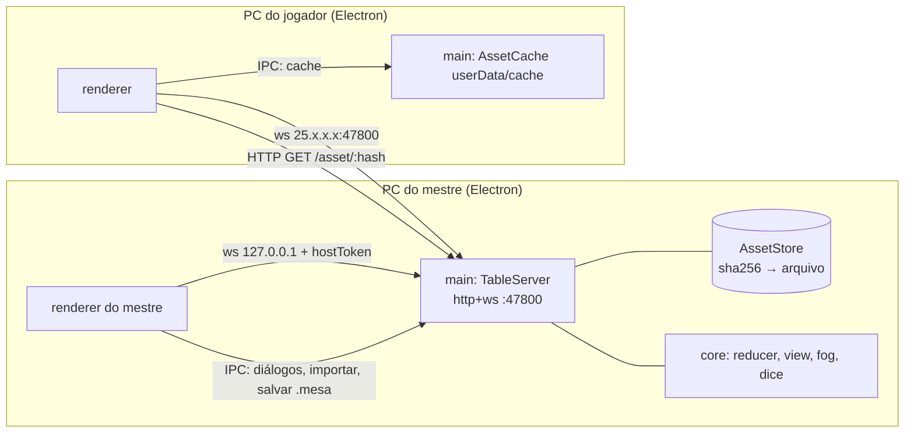
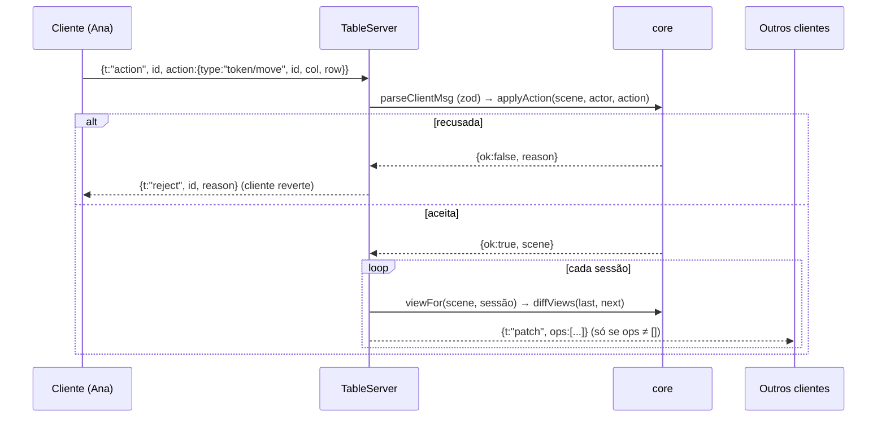

# Mesa RPG LAN — MVP Design

**Spec**: `.specs/features/mesa-mvp/spec.md`
**Status**: Approved

---

## Architecture Overview

One Electron app. The main process can host a `TableServer` (HTTP + WebSocket on the same port). Every window, including the master's, is a client that connects through WebSocket. The master's window connects to `127.0.0.1` with a host token that only the main process knows (user: "Servidor no main, todos via ws"). Every rule lives in `src/core`, which is pure TypeScript with no Node or DOM. Vitest tests the core directly, and the server with real `ws` clients. The renderer only draws the view it receives and sends actions.





**Where the rules run.** Everything that decides what a user sees runs in `src/core`: permissions, token visibility (hidden or under fog), fog cells, dice, snap to grid, grid detection, manifest and palette parsing, `.mesa` validation, message validation and rate limits. The server calls these functions. The renderer calls only `snapToCell`, `rulerDistance` and `detectGrid` (the core function), so the result it shows is the one the tests cover.

---

## Code Reuse Analysis

### Existing Components to Leverage

| Component | Location | How to Use |
| --- | --- | --- |
| None | - | Greenfield repo; the only file is the plan |
| Grid detection method of the Blender kit | Plan, "Integração" section | Same idea: mean brightness per column/row, then FFT for the period. Rewritten in TS in `core/grid-detect.ts` |

### Integration Points

| System | Integration Method |
| --- | --- |
| Kit do Blender (pasta de tokens) | `dialog.showOpenDialog({properties:["openDirectory"]})`; main reads `*.png` + optional `<nome>.json` |
| `palette.json` | Chosen by the master via file dialog; `core/palette.ts` validates it |
| Hamachi / Radmin | Just IP reachability; `main/netinfo.ts` lists IPv4 from `os.networkInterfaces()` |
| Windows Firewall | Windows' own prompt appears when the exe listens on `0.0.0.0`; the host screen shows the hint |

---

## Components

### core/protocol

- **Purpose**: zod schemas and types for every client→server and server→client message; rejects anything else.
- **Location**: `mesa-rpg/src/core/protocol.ts`
- **Interfaces**:
  - `parseClientMsg(raw: string): ClientMsg | null` - NET-15
  - `type Action` = `token/place | token/move | token/update | token/remove | token/hide | token/show | token/owner | grid/set | map/set | fog/brush | fog/rect | fog/coverAll | scene/load | roll | chat`
  - `type Ephemeral` = `ruler | ruler/end | ping | stroke`
- **Dependencies**: zod 4

### core/reducer

- **Purpose**: applies one action from one actor to the scene, with the permission checks.
- **Location**: `mesa-rpg/src/core/reducer.ts`
- **Interfaces**:
  - `applyAction(scene: Scene, actor: Actor, action: Action, ctx: {rng, now, newId}): {ok:true, scene, log?: LogEntry} | {ok:false, reason: RejectReason}` - NET-14, PERM-02..04, TOK-04..10, MAP-05/06, FOG-01/03/04/05/08, DICE-01, CHAT-01/02
- **Dependencies**: grid, fog, dice

### core/view

- **Purpose**: builds the scene each session is allowed to see, and the diff between two views.
- **Location**: `mesa-rpg/src/core/view.ts`
- **Interfaces**:
  - `viewFor(scene: Scene, viewer: Actor): View` - drops `hidden` tokens and tokens with a covered cell (unless the viewer owns them) for players; the master sees everything with `hidden` flagged - PERM-05/06, FOG-06/07
  - `diffViews(prev: View|null, next: View): PatchOp[]` - `token/upsert`, `token/remove`, `map`, `grid`, `fog`, `players`

### core/fog

- **Purpose**: fog cell grid as a bitset per scene.
- **Location**: `mesa-rpg/src/core/fog.ts`
- **Interfaces**:
  - `fogDims(map, grid): {colStart, rowStart, cols, rows}` - every cell that touches the image
  - `coverAll(dims): Fog`, `brush(fog, grid, x, y, radiusCells, mode)`, `rect(fog, grid, x0, y0, x1, y1, mode)`, `isCovered(fog, col, row)`, `tokenCovered(fog, token)` - FOG-01/03/04/05/06

### core/grid and core/grid-detect

- **Purpose**: cell math and automatic grid detection.
- **Location**: `mesa-rpg/src/core/grid.ts`, `mesa-rpg/src/core/grid-detect.ts`
- **Interfaces**:
  - `clampGrid(g: Partial<Grid>): Grid` - MAP-06
  - `cellAt(grid, x, y): {col, row}`, `cellOrigin(grid, col, row): {x, y}` - TOK-04/05
  - `rulerDistance(a, b): number` = `max(|dc|, |dr|)` - TOOL-01
  - `detectGrid(rgba: Uint8ClampedArray, width, height): {cell, offsetX, offsetY} | null` - mean luminance per column and per row, de-meaned, FFT (radix-2, zero-padded) → strongest period in 20..400 px; offset from the phase - MAP-03/04

### core/dice

- **Purpose**: parses and rolls the notation.
- **Location**: `mesa-rpg/src/core/dice.ts`
- **Interfaces**:
  - `parseDice(expr: string): DiceExpr | {error: string}` - DICE-04
  - `rollDice(expr: DiceExpr, rng: (max: number) => number): RollResult` - each die, which ones were kept, total - DICE-01/03; the server passes `max => crypto.randomInt(1, max + 1)` - DICE-02

### core/manifest, core/palette, core/image-info

- **Purpose**: kit files and image validation, with no I/O.
- **Location**: `mesa-rpg/src/core/manifest.ts`, `palette.ts`, `image-info.ts`
- **Interfaces**:
  - `parseManifest(json: string|null, fileName: string): {name, faction, size}` - TOK-01..03
  - `parsePalette(json: string|null): FactionColors` - TOK-09
  - `imageInfo(bytes: Uint8Array): {type: "png"|"jpeg"|"webp", width, height} | null` - magic bytes and header; plus the 50 MB limit - MAP-09

### core/mesa-file

- **Purpose**: encodes and decodes `.mesa`.
- **Location**: `mesa-rpg/src/core/mesa-file.ts`
- **Interfaces**:
  - `encodeMesa(scene: Scene, assets: Map<hash, Uint8Array>): string`
  - `decodeMesa(text: string, sha256: (b) => string): {scene, assets} | {error}` - validates schema, version and every embedded hash - SAVE-01..04

### core/ratelimit and core/names

- **Location**: `mesa-rpg/src/core/ratelimit.ts`, `mesa-rpg/src/core/session-rules.ts`
- **Interfaces**: `createLimiter(max=30, windowMs=10000)` - TOOL-05; `validateJoin(name, connectedNames, playerCount): ok | "Nome inválido" | "Nome já em uso" | "Mesa cheia"` - NET-07, NET-09

### main/table-server

- **Purpose**: HTTP + ws server; sessions; applies actions through the core; sends patches, log and ephemeral events; serves assets.
- **Location**: `mesa-rpg/src/main/table-server.ts`
- **Interfaces**:
  - `startTableServer({port, host:"0.0.0.0", store, hostToken}): Promise<TableServer>` - rejects with `EADDRINUSE` → "Porta <porta> em uso" - NET-02, NET-05
  - `server.addLibrary(items)`, `server.setScene(scene)`, `server.getSceneForSave()`, `server.close()` - closing sends `{t:"closed"}` to everyone - NET-13
  - `GET /asset/:hash` serves only hashes referenced by the scene or the library - ASSET-06
- **Dependencies**: ws 8, node:http, core

### main/asset-store and main/asset-cache

- **Location**: `mesa-rpg/src/main/asset-store.ts`, `mesa-rpg/src/main/asset-cache.ts`
- **Interfaces**: `store.put(bytes): hash` (sha256), `store.get(hash)`; `cache.has/get/put(hash, bytes)` under `app.getPath("userData")/cache`, with the hash checked on put - ASSET-01..05

### main/index, main/ipc, main/netinfo

- **Purpose**: Electron lifecycle, window, IPC handlers (dialogs, import, save/load `.mesa`, host/stop, cache, clipboard), list of IPs.
- **Location**: `mesa-rpg/src/main/index.ts`, `ipc.ts`, `netinfo.ts`
- **Interfaces**: `listAddresses(): {ip, label: "Hamachi"|"Radmin"|"Rede"}[]` - NET-03; `validatePort(text)` lives in `core/session-rules.ts` - NET-04

### preload

- **Location**: `mesa-rpg/src/preload/index.ts`
- **Interfaces**: `window.mesa` via `contextBridge`: `host(port)`, `stopHost()`, `importMap()`, `importTokens()`, `loadPalette()`, `saveScene()`, `loadScene()`, `cacheGet/cachePut(hash)`, `copy(text)`, `addresses()`

### renderer/net/table-client

- **Purpose**: ws connection, join, reconnection (every 3 s for up to 60 s), applies patches to the local view, downloads missing assets with the 3-try retry.
- **Location**: `mesa-rpg/src/renderer/net/table-client.ts`, `asset-loader.ts`
- **Interfaces**: `connect({ip, port, name, hostToken?})`, `send(action) → Promise<ok|reject>`, events `view`, `log`, `ephemeral`, `status` - NET-06/08/10/11/12, ASSET-02..05
- **Testable in Node** (it uses the global `WebSocket` and an injected `fetch`/cache), so Vitest covers the reconnection and the retries.

### renderer/board (PixiJS 8)

- **Purpose**: draws the map, grid, tokens (ring, name, size), fog, and ruler/ping/drawing overlays; handles zoom and pan.
- **Location**: `mesa-rpg/src/renderer/board/board.ts`, `token-sprite.ts`, `fog-layer.ts`, `overlays.ts`, `camera.ts`
- **Interfaces**: `board.render(view)`; `board.setTool("select"|"ruler"|"ping"|"draw"|"fog-brush"|"fog-rect")`; `camera` zoom 0.1–4.0 centred on the cursor - MAP-07/08
- **Test hook**: with `MESA_TEST=1`, `window.__mesaTest.board()` returns what is drawn (tokens with x/y/size/alpha, visible fog cells, overlays), so Playwright can assert the canvas.

### renderer/ui (DOM, no framework)

- **Location**: `mesa-rpg/src/renderer/ui/home.ts`, `host-info.ts`, `sidebar-players.ts`, `library.ts`, `token-editor.ts`, `grid-panel.ts`, `log-panel.ts`, `fog-panel.ts`, `status-overlay.ts`
- **Purpose**: home screen (Hospedar/Entrar), IP and port with "Copiar", players list, token library, token editor (name, faction, size, owner, hide, remove), grid panel, dice and chat log, fog tools, status messages ("Baixando arquivos n/total", "Conexão… perdida", "O mestre encerrou a mesa"). Text is inserted with `textContent` only - CHAT-04

---

## Data Models

```typescript
type Faction = "grupo" | "inimigo" | "npc" | "neutro"
interface Grid { cell: number; offsetX: number; offsetY: number; color: string; opacity: number } // 10..500, 0..cell, #rrggbb, 0..1
interface MapRef { hash: string; width: number; height: number }
interface Token { id: string; name: string; hash: string; faction: Faction; size: 1|2|3; col: number; row: number; owner: string|null; hidden: boolean }
interface Fog { colStart: number; rowStart: number; cols: number; rows: number; covered: string } // base64 bitset, 1 = coberta
interface Scene { map: MapRef|null; grid: Grid; tokens: Record<string, Token>; fog: Fog|null }
interface Actor { role: "master"|"player"; name: string }
interface LogEntry { id: string; at: number; author: string; kind: "chat"|"roll"; text: string; roll?: RollResult }
interface RollResult { expr: string; terms: { kind: "dice"|"const"; sign: 1|-1; sides?: number; rolls?: number[]; kept?: boolean[]; value: number }[]; total: number }
interface View { role: Actor["role"]; map: MapRef|null; grid: Grid; tokens: Record<string, Token>; fog: Fog|null; players: string[] }
interface MesaFile { format: "mesa"; version: 1; scene: Scene; assets: Record<string, string /* base64 */> }
interface LibraryItem { hash: string; name: string; faction: Faction; size: 1|2|3 }
```

**Relationships**: `Token.hash` and `MapRef.hash` point into the `AssetStore`. `Token.owner` is a player's name, which is why reconnecting with the same name gets the tokens back (NET-11). The server keeps the log (at most 200 entries) outside the `Scene`. `.mesa` saves only the `Scene`.

---

## Error Handling Strategy

| Error Scenario | Handling | User Impact |
| --- | --- | --- |
| Invalid port | `validatePort` before `listen` | "Porta inválida" |
| Port in use | `listen` rejects with `EADDRINUSE` | "Porta <porta> em uso", back to home |
| Join timeout | client aborts the socket after 5 s | "Não foi possível conectar a IP:porta", fields kept |
| Name invalid, in use, table full | server sends `{t:"join-error", reason}` and closes | the matching message |
| Malformed message | `parseClientMsg` → null, ignored | none |
| Action refused | `{t:"reject", id, reason}` | token goes back to where it was |
| Drop | backoff of 3 s, 20 tries | overlay "tentando reconectar", then "Conexão perdida" |
| Master closes | `{t:"closed"}` before `wss.close()`; `before-quit` sends it too | "O mestre encerrou a mesa" |
| Corrupted asset | hash checked after download, 3 tries | "Falha ao baixar arquivo" |
| Invalid image, invalid `.mesa` | `imageInfo` / `decodeMesa` return an error | "Imagem inválida" / "Arquivo .mesa inválido", scene kept |

---

## Risks & Concerns

| Concern | Location (file:line) | Impact | Mitigation |
| --- | --- | --- | --- |
| electron-builder `portable` built on Linux may still need Wine | `mesa-rpg/electron-builder.yml` | PKG-01 fails here | The first packaging task runs `npm run dist` early (Phase 1) with `signAndEditExecutable: false`. If it fails, I stop and ask before switching target, because that is a departure from the spec |
| No auth on the LAN: anyone who reaches IP:port can join | `main/table-server.ts` | Anyone on the VPN joins as a player | Accepted in the spec (Out of Scope). The master is set by a random `hostToken` that never leaves the PC, so no remote client becomes master |
| Asset HTTP endpoint | `main/table-server.ts` | Reading arbitrary files | Only hashes in the `AssetStore` that are referenced; `hash` matches `^[0-9a-f]{64}$`; never a path |
| XSS through names/chat in Electron | `renderer/ui/*` | Code execution | `textContent` only; `contextIsolation: true`, `nodeIntegration: false`, `sandbox: true`, CSP `default-src 'self'` plus `connect-src ws: http:` |
| Canvas is opaque to E2E | `renderer/board` | UI tests cannot see tokens | `window.__mesaTest.board()` hook, only when `MESA_TEST=1` |
| Grid FFT on 2000 px | `core/grid-detect.ts` | Slow import | 1D FFT on 2048 points is trivial; the image is decoded once in the renderer |
| TypeScript 7 is current, but typescript-eslint 8 supports `<6.1` | `package.json` | Lint breaks | Pin `typescript@~6.0` |
| E2E opens real windows on `DISPLAY=:0` | `e2e/` | Windows pop up while tests run | Accepted; tests use random ports and separate `--user-data-dir` per window |

---

## Tech Decisions

| Decision | Choice | Rationale |
| --- | --- | --- |
| Build tooling | `electron-vite` 6 + Vite 8 | Standard main/preload/renderer split on Vite, as the plan asks |
| Versions | electron 45, pixi.js 8, ws 8, zod 4, vitest 5, @playwright/test 1.65, typescript ~6.0, Node 22.16 (`.nvmrc`) | Current versions that work together (checked with `npm view` on 2026-11-08) |
| Asset transport | HTTP `GET /asset/:hash` on the same port as ws | Large binaries outside the JSON channel; same port, nothing else to open in the firewall |
| Diffs | per session: `viewFor` + `diffViews` against the last view sent | Diffs and visibility filtering in one place; whatever a player may not see never leaves the server |
| Fog | bitset per grid cell | Exact token visibility; 432 bits for 24x18 |
| Renderer UI | Plain DOM + TS, no framework | Few screens; one less dependency |
| Join timeout and reconnection | 5 s; 3 s × 20 tries | Spec NET-08 / NET-10 |
